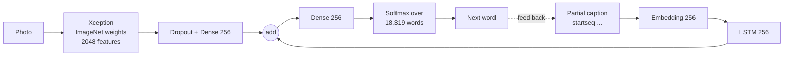

<h1 align="center">Image Captioning on Flickr</h1>

<b>Two ways to teach a model to describe a photo: a CNN+LSTM built from scratch, and a pretrained GIT transformer.</b>

  
  
  
  

> Final project of the **Master Machine Learning and AI Diploma** at AMIT Learning, Cairo (June 2023 to February 2024). Notebooks were run on Kaggle in March 2024.

## What it does

Give the model a photo, get back a sentence.

| Photo | Reference captions (excerpt) | LSTM model said |
|---|---|---|
| Strike at a university, a person speaking at a podium | "person speaks at protest on college campus", "woman is speaking at podium outdoors" | "crowd of people are walking down street" |

The caption is generic and only partly right, which is typical for a small model trained from scratch.

## Results

**Fine-tuned GIT-base (Flickr8k, 500 held-out test images, 4-beam search)**

| Metric | Pretrained GIT-base | After fine-tuning |
|---|---|---|
| BLEU-1 | 0.5409 | **0.7458** |
| BLEU-2 | 0.3900 | **0.5884** |
| BLEU-3 | 0.2740 | **0.4525** |
| BLEU-4 | 0.1917 | **0.3421** |
| ROUGE-L | 0.4249 | **0.5543** |

**Xception + LSTM (Flickr30k, first 1,000 test images, greedy decoding)**

| Model | BLEU-1 | BLEU-2 |
|---|---|---|
| after 25 epochs | 0.574 | 0.329 |
| after more training | **0.582** | **0.338** |

The two tables are not directly comparable: they use different datasets, test sets, decoding and tokenization. Scores are from a single training run and do not match published benchmarks. LSTM training token accuracy ended around 39 to 43%.

## Approach 1: Xception + LSTM (from scratch)

Notebook: [`image-caption-generator-lstm.ipynb`](image-caption-generator-lstm.ipynb) ([view on Kaggle](https://www.kaggle.com/code/ahmedesmail16/image-caption-generator))

- **Data:** Flickr30k, 31,783 images and 158,915 captions. Split by image: 25,426 train, rest test (80/20).
- **Text:** `startseq` / `endseq` markers, vocabulary of 18,319 words, captions up to 74 tokens.
- **Training:** categorical cross-entropy, Adam, batch size 32, a custom data generator, 25 epochs and then more.
- **Inference:** greedy decoding, one word at a time.

## Approach 2: fine-tuning GIT-base

Notebook: [`image-captioning-flickr8k-git-finetuning.ipynb`](image-captioning-flickr8k-git-finetuning.ipynb) ([view on Kaggle](https://www.kaggle.com/code/ahmedesmail16/image-captioning-on-flickr8k-fine-tuning))

[GIT](https://huggingface.co/microsoft/git-base) is a pretrained image-to-text transformer from Microsoft. The notebook measures it before and after fine-tuning on the same held-out images.

- **Data:** Flickr8k, five captions per image, split by image: 7,391 train, 200 validation, 500 test images.
- **Training:** Hugging Face `Trainer`, learning rate 5e-5, batch size 8 with gradient accumulation 4 (effective batch 32), mixed precision (fp16), 3 epochs. The epoch with the lowest validation loss is kept (validation loss 2.130, 2.074, 2.051).
- **Evaluation:** 4-beam search, BLEU-1 to BLEU-4 and ROUGE-L against all five reference captions of each test image.
- **Result:** BLEU-4 rose from 0.19 to 0.34 and ROUGE-L from 0.42 to 0.55. Part of the quality comes from GIT's pretraining: the model already scored BLEU-1 0.54 before fine-tuning.

## How to run

1. Open a notebook on Kaggle (links above) or upload the `.ipynb` to your own Kaggle account.
2. Add the matching dataset: Flickr30k for the LSTM, Flickr8k for GIT.
3. Turn on a GPU and run all cells.

## Project story

I built the LSTM first to understand how a decoder learns language one word at a time, using a data generator so the dataset fits in memory. Then I fine-tuned a pretrained transformer (GIT) and measured it against its own starting point. Both notebooks are kept as they were run.

## Limitations

- Single training run with one random seed, so small differences between runs are not meaningful.
- BLEU and ROUGE-L reward word overlap with the reference captions. They do not measure whether a caption is correct, and no CIDEr or human evaluation was done.
- The LSTM and GIT results use different datasets and evaluation settings (Flickr30k vs Flickr8k, greedy vs beam search), so they cannot be compared directly.
- Flickr8k is small and mostly shows people, dogs and outdoor scenes. The model may caption other kinds of images poorly.
- No demo app or saved model in this repository.
