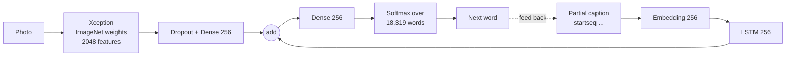

<h1 align="center">Image Captioning on Flickr</h1>

<b>Two ways to teach a model to describe a photo: a CNN+LSTM built from scratch, and a pretrained GIT transformer.</b>

  
  
  
  

> Final project of the **Master Machine Learning and AI Diploma** at AMIT Learning, Cairo (June 2023 to February 2024). Notebooks were run on Kaggle in March 2024.

## What it does

Give the model a photo, get back a sentence.

| Photo | Reference captions (excerpt) | LSTM model said |
|---|---|---|
| Strike at a university, a person speaking at a podium | "person speaks at protest on college campus", "woman is speaking at podium outdoors" | "crowd of people are walking down street" |

It is generic and only partly right. That is typical for a small model trained from scratch, and the honest picture of where this one stands.

## Results

| Model | Data | Metric | Score |
|---|---|---|---|
| Xception + LSTM, after 25 epochs | Flickr30k, first 1,000 test images | BLEU-1 / BLEU-2 | **0.574 / 0.329** |
| Xception + LSTM, after more training | Flickr30k, first 1,000 test images | BLEU-1 / BLEU-2 | **0.582 / 0.338** |
| GIT-base fine-tuning | Flickr8k | none recorded | run stopped by GPU memory during the first evaluation |

BLEU uses whitespace tokens and greedy decoding, so these numbers are not comparable to published benchmarks. Training token accuracy for the LSTM ended around 39 to 43%.

## Approach 1: Xception + LSTM (from scratch)

Notebook: [`image-caption-generator-lstm.ipynb`](image-caption-generator-lstm.ipynb) ([view on Kaggle](https://www.kaggle.com/code/ahmedesmail16/image-caption-generator))

- **Data:** Flickr30k, 31,783 images and 158,915 captions. Split by image: 25,426 train, rest test (80/20).
- **Text:** `startseq` / `endseq` markers, vocabulary of 18,319 words, captions up to 74 tokens.
- **Training:** categorical cross-entropy, Adam, batch size 32, a custom data generator, 25 epochs and then more.
- **Inference:** greedy decoding, one word at a time.

## Approach 2: fine-tuning GIT-base

Notebook: [`image-caption-generator-git.ipynb`](image-caption-generator-git.ipynb) ([view on Kaggle](https://www.kaggle.com/code/a7medesmail162/image-caption-generator-transformer-v6))

[GIT](https://huggingface.co/microsoft/git-base) is a pretrained image-to-text transformer from Microsoft.

- **Data:** Flickr8k, 99% train and 1% test.
- **Setup:** Hugging Face `Trainer`, learning rate 5e-5, batch size 16 with gradient accumulation 16, 5 epochs planned, WER as the planned metric.
- **What happened:** about one epoch ran, then a CUDA out-of-memory error hit the first evaluation on a 16 GB Kaggle GPU, so no validation score was recorded.
- **Output:** the notebook ends with example captions, for example "a brown and white dog runs through the grass". They are qualitative examples, not measured results. GIT-base already captions well before fine-tuning.

## How to run

1. Open a notebook on Kaggle (links above) or upload the `.ipynb` to your own Kaggle account.
2. Add the matching dataset: Flickr30k for the LSTM, Flickr8k for GIT.
3. Turn on a GPU and run all cells.
4. For GIT, lower `per_device_eval_batch_size` if you hit the same out-of-memory error.

## Project story

I built the LSTM first to understand how a decoder learns language one word at a time, using a data generator so the dataset fits in memory. Then I tried a pretrained transformer to compare. I ran out of GPU memory on the second one and did not go back to finish the evaluation. Both notebooks are kept as they were run.

## Limitations

- BLEU on 1,000 test images only. No beam search, no CIDEr or ROUGE, no human evaluation.
- The two approaches use different datasets (Flickr30k and Flickr8k), so they cannot be compared directly yet.
- No demo app or saved model in this repository.

## Next steps

- [ ] Finish the GIT run with a smaller evaluation batch and record BLEU and ROUGE
- [ ] Evaluate both models on the same test set
- [ ] Add beam search to the LSTM decoder
- [ ] Add a small demo that takes an uploaded photo
